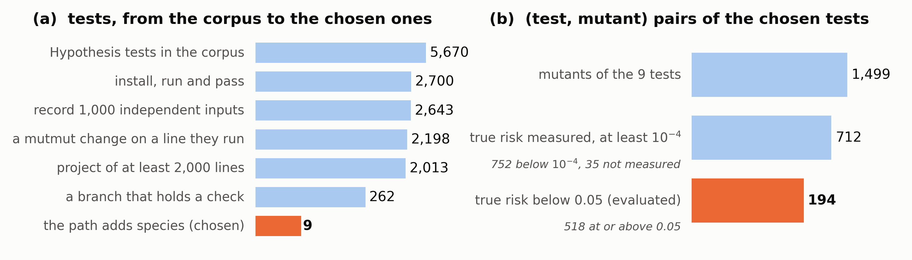

# Details of the evaluation setup

This page gives the details of the setup of the evaluation in the FPBT 2027 talk abstract on postcondition-aware residual risk estimation for property-based testing.

(a) Each step keeps the tests of the step before that meet one more condition. (b) The mutants of the nine chosen tests and the pairs evaluated. PDF version: [funnel.pdf](funnel.pdf).

## Tests

We start from the 5,670 Hypothesis tests in the PBT corpus of Ravi and Coblenz (*An Empirical Evaluation of Property-Based Testing in Python*, OOPSLA 2025). Measuring residual risk on a test requires that the test installs, runs and passes at the commit the corpus records, that its executions on independent inputs can be recorded, and that a fault can be put in at an SUT line it runs; 2,198 tests meet these.

So that the projects are of real size and the postconditions have structure, we keep the 262 tests whose project has at least 2,000 lines and whose postcondition has a branch that holds a check.

So that SUT coverage alone could reasonably leave a bug unfound while the post-path can change the estimate, we keep the nine tests that satisfy the following on the correct code, among 1,000 independent inputs: at most 50 inputs run a set of SUT lines that no other input runs, so SUT coverage has nearly stopped growing, and at least five more inputs are set apart from all others once their post-path is counted.

## Faults and pairs

As faults, we put mutants into the SUT: every single change, at an SUT line a chosen test runs, by a mutation operator of [mutmut](https://github.com/boxed/mutmut), the Python mutation testing tool that Ravi and Coblenz used, such as `<` to `<=` or `+` to `-`. Each mutant and the chosen test that runs its line form a (test, mutant) pair: 1,499 pairs.

The true risk of a pair is the probability that an input drawn from the test's generator violates the property. We estimate it by Monte Carlo sampling of independent inputs, stopping at 100 violations. It was measured as at least $10^{-4}$ on 712 pairs (752 pairs are below $10^{-4}$, and 35 could not be measured). The 194 pairs whose true risk is below 0.05 are evaluated; they are on six of the nine tests, from four projects: ndindex (array indexing), MyGrad (automatic differentiation), clkhash (record linkage) and pyscal (reservoir simulation).

## Campaigns

A developer can stop a campaign at any point before it finds a counterexample, so a risk estimate must hold whatever length the campaign ends at. For each pair we therefore run 100 campaigns, each a sequence of passing executions as long as a run of the test that has not yet found a counterexample: with true risk $p$, a run passes $l$ inputs in a row with probability $(1-p)^l$, and we draw each campaign's length from this distribution, up to its 95th percentile. For the fault of Figure 1 of the abstract ($p = 0.0044$), the lengths range from 4 to 673 executions; the campaign of 292 executions in Section 2 of the abstract is one of them. Every estimator is computed on the same campaigns.
